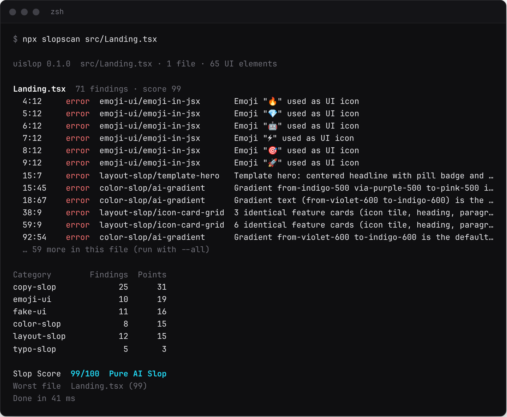
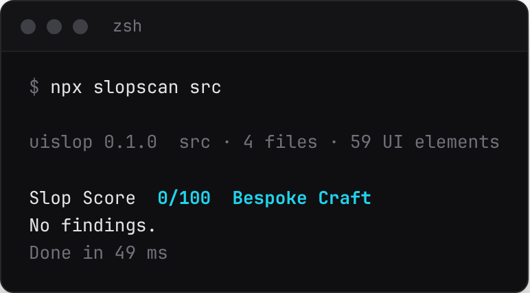

<div align="center">

# uislop

**Находит и убирает «шаблонный ИИ-вид» в интерфейсах на React, Next.js и Tailwind.**

Локально и детерминированно. Без LLM, без API-ключей, меньше секунды.

[](https://github.com/stonexy1/uislop/actions/workflows/ci.yml)
[](https://www.npmjs.com/package/slopscan)
[](package.json)
[](LICENSE)

[English](README.md) · **Русский**



</div>

`slopscan` оценивает, насколько фронтенд выглядит сгенерированным нейросетью. Он разбирает файлы .tsx, .jsx, .css
и .html, применяет 20 правил в шести категориях и выдаёт Slop Score от 0 до 100 с файлом и строкой каждой находки.
Затем он готовит для вашего ИИ-агента точный промпт на исправление.

- **Локально и детерминированно**: без LLM, без API-ключа, без сетевых запросов. Тестовый корпус из 300 файлов
  (62 000 строк) сканируется примерно за 0,75 с вместе с запуском Node.
- **На основе AST** для JSX/TSX (парсер Babel): читает `className`, `cn()`, `clsx()`, `cva()`, шаблонные строки и `@apply`.
- **Замыкает цикл**: пишет fix-промпт для Claude Code или Cursor, SVG-бейдж, CI-проверку и устанавливает агентский скилл.
- **Лёгкий**: одна зависимость во время работы (`@babel/parser`). Node.js 20.12 или новее.

## Содержание

- [Быстрый старт](#быстрый-старт)
- [Что он находит](#что-он-находит)
- [Вывод](#вывод)
- [Оценка и уровни](#оценка-и-уровни)
- [Правила](#правила)
- [Команды и флаги](#команды-и-флаги)
- [Fix-промпты](#fix-промпты) · [Агентский скилл](#агентский-скилл) · [Бейдж](#бейдж) · [CI](#ci)
- [Конфигурация](#конфигурация) · [Комментарии-исключения](#комментарии-исключения)
- [Ограничения](#ограничения) · [Участие в разработке](#участие-в-разработке) · [Лицензия](#лицензия)

## Быстрый старт

```sh
npx slopscan                       # 1. просканировать текущую папку
npx slopscan src --prompt | pbcopy # 2. скопировать fix-промпт для агента
npx slopscan init                  # 3. научить Claude Code / Cursor избегать этих паттернов
```

Пакет устанавливает две равноценные команды: `slopscan` и `uislop`. В примерах ниже используется `npx slopscan`.

## Что он находит

| Категория | Типичный паттерн | Что сделать вместо |
|---|---|---|
| `color-slop` | `from-indigo-500 via-purple-500 to-pink-500`, `shadow-purple-500/50`, `#000` | Нейтральная шкала zinc или slate и один акцент |
| `emoji-ui` | Эмодзи вместо иконок в заголовках, кнопках и карточках | SVG-иконки (lucide-react или inline SVG) |
| `copy-slop` | Штампы («Supercharge your…», «Unleash the power…»), «Acme Corp», «John Doe» | Конкретный текст: что делает продукт и для кого |
| `layout-slop` | Три одинаковые карточки с иконкой, шаблонный hero, `rounded-3xl` и `shadow-2xl` повсюду | Асимметрия, один радиус, рамки вместо тяжёлых теней |
| `typo-slop` | Цены и метрики без `tabular-nums`, абзацы без ограничения ширины | `tabular-nums`, `max-w-prose` |
| `fake-ui` | `href="#"`, `onClick={() => {}}`, выдуманные «99.9% uptime» | Настоящие ссылки и обработчики, реальные данные или ничего |

## Вывод

```
uislop 0.1.0  src · 4 files · 124 UI elements

src/Landing.tsx  71 findings · score 99
  15:7     error  layout-slop/template-hero        Template hero: centered headline with pill badge…
  15:45    error  color-slop/ai-gradient           Gradient from-indigo-500 via-purple-500 to-pink-…
  38:9     error  layout-slop/icon-card-grid       3 identical feature cards (icon tile, heading, p…
  … 59 more in this file (run with --all)

Category        Findings  Points
copy-slop             30      23
fake-ui               26      23
color-slop            15      18
emoji-ui              15      16
layout-slop           20      13
typo-slop             12       5

Slop Score  98/100  Pure AI Slop
Worst file  src/Landing.tsx (99)
Done in 47 ms
```

Отчёт CLI выводится на английском. Если оценка выше 15, в конце отчёта печатается блок с fix-промптом.

Для сравнения, чистый проект:



## Оценка и уровни

| Оценка | Уровень |
|---|---|
| 0-15 | Bespoke Craft (ручная работа) |
| 16-35 | Minor Slop (немного шаблонности) |
| 36-60 | Template Vibe (вид шаблона) |
| 61-100 | Pure AI Slop (чистый ИИ-шаблон) |

Каждая находка стоит `вес × множитель серьёзности` баллов (error 1.5, warn 1.0, info 0.5). Сумма баллов делится на
число UI-единиц (элементы JSX/HTML плюс блоки правил CSS, не меньше 50), и результат переводится в шкалу 0-100 по
формуле `score = round(100 × (1 − e^(−2 × density)))`. Новые находки никогда не снижают оценку, а большой проект с
парой находок остаётся около 0. Оценки отдельных файлов считаются по той же формуле; на них ориентируется
`--max-file-slop`.

## Правила

| ID правила | Вес | По умолчанию | Что находит |
|---|---|---|---|
| `color-slop/ai-gradient` | 3 | warn, error при 2+ фиолетовых/индиго/розовых точках | `from-indigo-500 via-purple-500 to-pink-500`, CSS `linear-gradient` тех же оттенков |
| `color-slop/neon-shadow` | 2 | warn | `shadow-purple-500/50`, цветное свечение в `box-shadow` |
| `color-slop/pure-black-white` | 1.5 | warn | `bg-black`, `text-black`, `#000` (кроме вариантов `dark:`) |
| `color-slop/ai-accent-palette` | 1 | info | 5+ акцентных классов indigo/violet/purple/fuchsia/pink в одном файле |
| `emoji-ui/emoji-in-jsx` | 2 | warn, error если эмодзи служит иконкой | Эмодзи в видимом тексте, атрибутах и CSS `content` |
| `copy-slop/cliche-phrase` | 2 | warn | Штампы вроде «supercharge», «unleash the power», «next-generation» |
| `copy-slop/placeholder-content` | 2 | warn | «Acme Corp», «John Doe», «Lorem ipsum», номера `(555)`, `@example.com` |
| `copy-slop/buzzword-density` | 1 | info | Два и больше модных слова в одном тексте, например «powerful, seamless, intuitive» |
| `layout-slop/icon-card-grid` | 3 | error | 3+ одинаковые карточки с плашкой-иконкой, заголовком и абзацем в сетке |
| `layout-slop/identical-card-grid` | 2 | warn | 3+ одинаковые карточки «заголовок плюс абзац» в сетке |
| `layout-slop/template-hero` | 3 | error, warn без «пилюли» | Центрированный hero, бейдж-пилюля, заголовок `text-6xl`, «Get Started» / «Learn More» |
| `layout-slop/rounded-3xl-overuse` | 1 | warn | `rounded-3xl` или радиус от 24px 3+ раза в файле |
| `layout-slop/heavy-shadow` | 1 | warn | `shadow-xl` / `shadow-2xl` на плоских поверхностях 2+ раза в файле |
| `typo-slop/missing-tabular-nums` | 1 | warn, info для динамических значений | Числа, цены и ячейки таблиц без `tabular-nums` |
| `typo-slop/unconstrained-paragraph` | 1 | warn | Абзацы от 160 символов без `max-w-*` или `prose` |
| `fake-ui/dead-link` | 2 | warn | `href="#"`, `javascript:void(0)` |
| `fake-ui/noop-handler` | 2 | warn | `onClick={() => {}}`, обработчики submit, которые только вызывают `preventDefault()` |
| `fake-ui/console-handler` | 2 | warn | Обработчики, которые только вызывают `console.log` или `alert` |
| `fake-ui/fake-metric` | 3 | warn | Статичные «99.9% uptime», «10,000+ users», «4.9/5» |
| `fake-ui/placeholder-asset` | 1.5 | warn | via.placeholder.com, picsum.photos, i.pravatar.cc и похожие хосты |

Параметры правил: `rounded-3xl-overuse.minCount` (3), `heavy-shadow.minCount` (2),
`unconstrained-paragraph.minChars` (160), `icon-card-grid.minSiblings` и `identical-card-grid.minSiblings` (3),
`ai-accent-palette.minUses` (5), `buzzword-density.minDistinct` (2).

## Команды и флаги

```
npx slopscan [path...] [options]
npx slopscan init [--cursor] [--agents] [--all] [--force] [--dir <path>]
```

| Флаг | Действие |
|---|---|
| `--prompt` | Вывести в stdout только fix-промпт |
| `--json` | Вывести весь результат в JSON (`schemaVersion: 1`) |
| `-q`, `--quiet` | Вывести только `98/100 Pure AI Slop` |
| `--badge [file.svg]` | Записать SVG-бейдж (по умолчанию `./uislop-badge.svg`) |
| `--ci` | Выйти с кодом 1, если оценка выше порога (по умолчанию 35) |
| `--max-slop <n>` | Порог для `--ci`; сам включает `--ci` |
| `--max-file-slop <n>` | Также падать, если любой отдельный файл выше `n` |
| `--config <path>` | Использовать указанный файл конфигурации |
| `--all` | Показать все находки, а не по 12 на файл |
| `--no-fix-prompt` | Не печатать блок fix-промпта |
| `--no-color` | Отключить цвета (`NO_COLOR` и `FORCE_COLOR` тоже учитываются) |

Коды выхода: 0 — успех или CI пройден, 1 — превышен порог CI (или `init` пропустил отличающийся файл),
2 — ошибка аргументов или конфигурации, 3 — внутренняя ошибка.

## Fix-промпты

```sh
npx slopscan src --prompt | pbcopy
```

Промпт содержит до 30 находок по убыванию влияния, сгруппированных по файлам с `L<строка>:<колонка>`, добавляет
дизайн-направление для сработавших категорий, запрещает менять логику и заканчивается шагом проверки:
`npx slopscan src --ci --max-slop 15`, пока команда не завершится с кодом 0.

## Агентский скилл

```sh
npx slopscan init              # пишет .claude/skills/uislop/SKILL.md
npx slopscan init --all        # плюс .cursor/skills и .agents/skills
```

`init` никогда не перезаписывает файл, отличающийся от встроенного скилла, без флага `--force`. Скилл также лежит в
этом репозитории в папке `skill/`, поэтому работает и `npx skills add stonexy1/uislop`. Он объясняет агенту, каких
паттернов избегать, и требует проверять работу командой `npx slopscan <path> --ci --max-slop 15`.

## Бейдж

```sh
npx slopscan --badge
```

```md

```

Бейдж показывает `UI Slop | 8/100 · Bespoke Craft` и окрашивается по уровню:

 

## CI

```yaml
- run: npx slopscan --ci --max-slop 20
```

## Конфигурация

`uislop.config.json` ищется в корне сканирования или в ближайшей родительской папке, вплоть до папки с
`package.json`. Все ключи необязательны.

```json
{
  "include": ["**"],
  "exclude": ["src/legacy/**"],
  "rules": {
    "emoji-ui": "off",
    "layout-slop/heavy-shadow": "info",
    "copy-slop/cliche-phrase": { "severity": "error", "weight": 3 },
    "layout-slop/rounded-3xl-overuse": { "options": { "minCount": 5 } }
  },
  "maxSlop": 20,
  "maxFileSlop": null,
  "ignore": [{ "files": ["src/marketing/**"], "rules": ["copy-slop"] }],
  "ignoreText": ["Acme"],
  "classFunctions": ["cx2"],
  "maxFileSize": 1000000
}
```

- Ключи `rules` — это ID правил или категории; значения — `"off"`, уровень серьёзности или
  `{ severity, weight, options }`.
- `exclude` и `classFunctions` дополняют значения по умолчанию. По умолчанию исключены файлы тестов, spec и story,
  `__tests__`, `__mocks__`, минифицированные файлы. `node_modules`, `dist`, `build`, `out`, `coverage` и папки,
  начинающиеся с точки, пропускаются всегда.
- `ignoreText` отбрасывает находки, в строке которых встречается одна из подстрок (без учёта регистра).
- `--max-slop` и `--max-file-slop` из командной строки имеют приоритет над конфигом.

## Комментарии-исключения

```tsx
// uislop-ignore color-slop/ai-gradient -- фирменный градиент, согласован с дизайном
<div className="bg-gradient-to-r from-violet-600 to-indigo-600" />

{/* uislop-ignore emoji-ui */}
<span>🎉</span>
```

- `uislop-ignore` на отдельной строке действует на следующую строку; после кода на той же строке — на эту строку.
- `uislop-ignore-next-line`, `uislop-ignore-line` и `uislop-ignore-file` — явные формы.
- После ключевого слова можно перечислить ID правил или категории; без них игнорируются все правила. Текст после
  `--` — это причина.
- Комментарий над многострочным тегом покрывает находки внутри этого тега. В CSS используется `/* */`, в HTML — `<!-- -->`.

## Ограничения

- Это эвристики: фиолетовый фирменный цвет, эмодзи в чатах или `max-w-*` у родительского компонента в другом
  файле могут дать ложные срабатывания. Используйте комментарии-исключения или конфиг.
- Префиксы классов Tailwind и собственные цвета темы не разрешаются.
- Файлы Vue и Svelte не сканируются.
- Папки с именами `build`, `out` и `dist` пропускаются на любой глубине, если их не передать как путь сканирования.
- В npm существует посторонний пакет с именем `uislop`. Этот проект публикуется как `slopscan`.

## Участие в разработке

Ложные срабатывания, пропущенные паттерны и идеи новых правил приветствуются. Прочитайте
[CONTRIBUTING.md](CONTRIBUTING.md) и откройте issue по форме
[false positive](https://github.com/stonexy1/uislop/issues/new?template=false_positive.yml) или
[rule request](https://github.com/stonexy1/uislop/issues/new?template=rule_request.yml). Писать можно на русском.

```sh
npm install
npm run typecheck
npm run build
npm test
```

Для сборки и тестов нужен Node.js 22.18 или новее; опубликованный `dist` работает на Node.js 20.12 или новее.

## Лицензия

[MIT](LICENSE)
